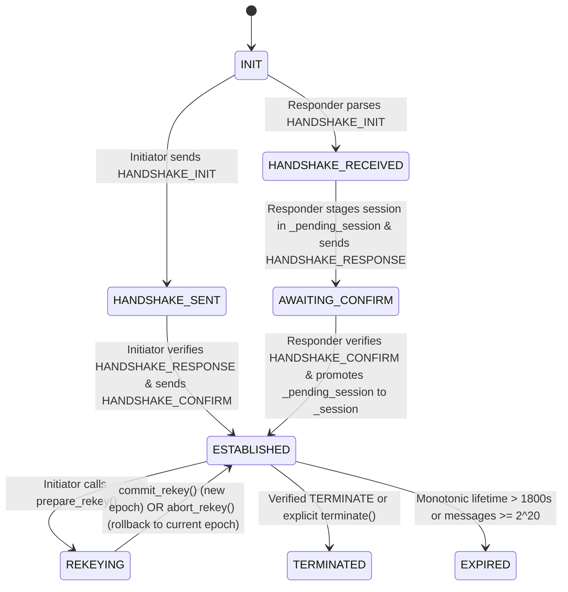

# UAV-C2-PQ-L2 v2 — Formal Protocol Specification

**Protocol Name:** `UAV-C2-PQ-L2`
**Protocol Version:** `2` (`PROTOCOL_VERSION = 2`, `__version__ = "2.0.0"`)
**Cryptographic Suite:** `ML-KEM-768` (FIPS 203) + `ML-DSA-65` (FIPS 204) + `HKDF-SHA-256` (RFC 5869) + `AES-256-GCM` (NIST SP 800-38D)
**Wire Compatibility:** Intentionally incompatible with `v1` (`PROTOCOL_VERSION = 1`). All `version != 2` packets are rejected at header parsing with `VersionError`.

---

## 1. Architectural Overview & Security Objectives

`UAV-C2-PQ-L2 v2` is a Layer 2 cryptographic command-and-control (C2) security protocol between an authorized **Ground Station** (`role = "ground_station"`, initiator/command sender) and an authorized **Unmanned Aerial Vehicle** (`role = "uav"`, responder/command receiver).

### Core Security Properties
1. **Mutual Post-Quantum Entity Authentication:** Both peers authenticate using pre-provisioned `ML-DSA-65` long-term signing keys verified against a local `TrustStore`.
2. **Role-Enforced Authorization:** Only a peer provisioned as `"ground_station"` may initiate handshakes, send `COMMAND` packets, initiate `REKEY`, or send `TERMINATE` to a `"uav"` responder. Only a peer provisioned as `"uav"` may respond to handshakes and execute received commands.
3. **Forward-Secret Key Establishment with Explicit Key Confirmation:** Ephemeral `ML-KEM-768` key encapsulation establishes shared secrets. Responder sessions remain in `AWAITING_CONFIRM` inside an isolated `_pending_session` slot until the initiator's encrypted and `ML-DSA-65`-signed `HANDSHAKE_CONFIRM` is verified over the length-framed handshake transcript.
4. **Defense-in-Depth Command Protection:** Every command packet is signed inside the plaintext (`ML-DSA-65`) and encrypted/authenticated on the wire (`AES-256-GCM`) with the 22-byte binary header bound as Additional Authenticated Data (`AAD`).
5. **Identity-Bound Chained Rekeying:** Mid-session rekeying (`REKEY_INIT` / `REKEY_RESPONSE`) is signed by both peers' long-term `ML-DSA-65` keys, chains the previous epoch's `root_secret` with the new `ML-KEM-768` shared secret, verifies an explicit 32-byte `HMAC-SHA-256` key confirmation tag, and transitions epochs atomically with safe rollback on error.
6. **Bounded Replay & DoS Resilience:** Sequence numbers and AEAD nonces are tracked in $O(1)$ memory (`NONCE_WINDOW_SIZE = 200`), and sequence window validation occurs prior to expensive `ML-DSA-65` signature verification.

---

## 2. Cryptographic Primitives & FIPS Byte Lengths

All inputs crossing into `liboqs` (`oqs`) or `cryptography` are validated against exact byte lengths in [`protocol/crypto_core.py`](file:///C:/Users/smanv/UAV_Security_Project/layer2_crypto_v2/protocol/crypto_core.py):

| Primitive | Standard | Parameter / Artifact | Exact Size (Bytes) |
| :--- | :--- | :--- | ---: |
| `ML-KEM-768` | NIST FIPS 203 | Public encapsulation key (`pk`) | `1,184` |
| `ML-KEM-768` | NIST FIPS 203 | Secret decapsulation key (`sk`) | `2,400` |
| `ML-KEM-768` | NIST FIPS 203 | Ciphertext (`ct`) | `1,088` |
| `ML-KEM-768` | NIST FIPS 203 | Shared secret (`ss`) | `32` |
| `ML-DSA-65` | NIST FIPS 204 | Public verification key (`pk`) | `1,952` |
| `ML-DSA-65` | NIST FIPS 204 | Secret signing key (`sk`) | `4,032` |
| `ML-DSA-65` | NIST FIPS 204 | Signature (`sig`) | `3,309` |
| `AES-256-GCM` | NIST SP 800-38D | Symmetric key / Nonce / Tag | `32` / `12` / `16` |
| `HKDF-SHA-256` | RFC 5869 | Root secret / Confirm key / Traffic key | `32` / `32` / `32` |

---

## 3. Wire Framing & Message Formats

### 3.1 Binary Message Header (`22 bytes`, Big-Endian, Unencrypted AAD)

Every wire packet begins with a 22-byte binary [`MessageHeader`](file:///C:/Users/smanv/UAV_Security_Project/layer2_crypto_v2/protocol/messages.py#L137-L195) (`struct` format `>BB16sI`):

| Offset | Size (Bytes) | Field | Type | Validation Rule |
| ---: | ---: | :--- | :--- | :--- |
| `0` | `1` | `version` | `uint8` | Must equal `2` (`PROTOCOL_VERSION`); else `VersionError` |
| `1` | `1` | `msg_type` | `uint8` | Must be in `{1, 2, 3, 4, 5, 6}`; else `MessageFormatError` |
| `2` | `16` | `session_id` | `bytes[16]` | 128-bit random session identifier |
| `18` | `4` | `sequence` | `uint32` | `0` for `HANDSHAKE_INIT`/`HANDSHAKE_RESPONSE` and `REKEY_RESPONSE`; $\ge 1$ for session packets |

**Message Type Identifiers:**
- `1` (`MSG_TYPE_HANDSHAKE_INIT`)
- `2` (`MSG_TYPE_HANDSHAKE_RESPONSE`)
- `3` (`MSG_TYPE_HANDSHAKE_CONFIRM`)
- `4` (`MSG_TYPE_COMMAND`)
- `5` (`MSG_TYPE_REKEY`)
- `6` (`MSG_TYPE_TERMINATE`)

### 3.2 Unencrypted Negotiation Packet Layout (`MSG_TYPE 1, 2`)
```text
+-----------------------+-----------------------------------------------+
| Header (22 B)         | UTF-8 JSON HandshakePayload                   |
+-----------------------+-----------------------------------------------+
```
- `HANDSHAKE_INIT` wire size (`gs1` $\to$ `uav1`): `13,287 B` (`22 B` header + `13,265 B` JSON).
- `HANDSHAKE_RESPONSE` wire size (`uav1` $\to$ `gs1`): `15,451 B` (`22 B` header + `15,429 B` JSON).

### 3.3 Encrypted Session Packet Layout (`MSG_TYPE 3, 4, 5, 6`)
```text
+-----------------------+------------------+----------------------------+------------------+
| Header (22 B, AAD)    | GCM Nonce (12 B) | AES-256-GCM Ciphertext     | GCM Tag (16 B)   |
+-----------------------+------------------+----------------------------+------------------+
```
- Minimum encrypted packet size: `50 bytes` (`22 + 12 + 16`).
- Maximum packet size: `65,536 bytes` (`MAX_PACKET_SIZE`), enforced before parsing.

---

## 4. Payload Schemas & Canonical Signing Structures

All JSON parsing uses `_strict_json_loads()` in [`protocol/messages.py`](file:///C:/Users/smanv/UAV_Security_Project/layer2_crypto_v2/protocol/messages.py#L80-L101), which enforces pre-parse byte limits, rejects non-object JSON roots, rejects unknown or missing fields, rejects control characters, and rejects `NaN`, `Infinity`, and `-Infinity`.

### 4.1 `HandshakePayload` (`HANDSHAKE_INIT` and `HANDSHAKE_RESPONSE`)
- **JSON Wire Fields (`13` required keys):**
  - `protocol_version`: `2`
  - `kem_algorithm`: `"ML-KEM-768"`
  - `sig_algorithm`: `"ML-DSA-65"`
  - `aead_algorithm`: `"AES-256-GCM"`
  - `kdf_algorithm`: `"HKDF-SHA-256"`
  - `sender_id`: Printable ASCII string (`1..64` chars)
  - `sender_role`: `"ground_station"` (in `INIT`) or `"uav"` (in `RESPONSE`)
  - `recipient_id`: Printable ASCII string (`1..64` chars)
  - `timestamp`: Finite positive float (`abs(now - timestamp) <= 60.0s`)
  - `handshake_nonce`: `32` hex chars (`16 B` random nonce)
  - `sender_signing_key`: `3,904` hex chars (`1,952 B` `ML-DSA-65` public key)
  - `sender_kem_key`: `2,368` hex chars (`1,184 B` initiator `ML-KEM-768` public key in `INIT`, and **echoed** in `RESPONSE`)
  - `kem_ciphertext`: `""` in `INIT`; `2,176` hex chars (`1,088 B` `ML-KEM-768` ciphertext) in `RESPONSE`
  - `signature`: `6,618` hex chars (`3,309 B` `ML-DSA-65` signature)
- **Canonical Signed Bytes (`HandshakePayload.canonical_bytes_for_signing`):**
  Deterministic UTF-8 JSON (`sort_keys=True, separators=(",", ":"), allow_nan=False`) over all fields above (excluding `signature`) plus `"session_id": session_id.hex()`.

### 4.2 `HANDSHAKE_CONFIRM` Payload & Length-Framed Transcript
- **Length-Framed Handshake Transcript (`Session.append_transcript`):**
  $$\text{Transcript} = \text{uint32\_be}(\text{len}(\text{init\_pkt})) \,\|\, \text{init\_pkt} \,\|\, \text{uint32\_be}(\text{len}(\text{resp\_pkt})) \,\|\, \text{resp\_pkt}$$
  where `init_pkt` and `resp_pkt` are the complete wire packets including their 22-byte headers.
- **Confirmation Signature Input (`Session.transcript_bytes_for_confirm`):**
  $$\text{ConfirmInput} = \texttt{"UAV-C2-PQ-L2-v2-HANDSHAKE-CONFIRM\textbackslash x00"} \,\|\, \text{Transcript}$$
- The initiator signs `ConfirmInput` with its long-term `ML-DSA-65` secret key (`3,309 B`) and encrypts the raw signature under `sender_enc_key` (`MSG_TYPE_HANDSHAKE_CONFIRM`, `sequence = 1`, total wire size `3,359 B`).

### 4.3 `CommandPayload` (`MSG_TYPE_COMMAND`)
- **JSON Wire Fields (`6` required keys):**
  - `sender_id`, `recipient_id`, `command` (must be in `VALID_COMMANDS`: `TAKEOFF`, `LAND`, `HOVER`, `RTL`, `WAYPOINT`, `SET_ALTITUDE`, `SET_SPEED`, `EMERGENCY_STOP`, `ABORT`), `params` (`0..512` printable ASCII chars), `timestamp` (finite positive float within $\pm 60\text{ s}$), `signature` (`6,618` hex chars = `3,309 B`).
- **Canonical Signed Bytes (`CommandPayload.canonical_bytes_for_signing`):**
  Binds `protocol_version`, `sender_id`, `recipient_id`, `session_id`, `sequence`, `command`, `params`, and `timestamp`.
- **Wire Size (`TAKEOFF ALTITUDE 10`):** `6,798 B` (`22 B` header + `12 B` nonce + `6,748 B` JSON ciphertext + `16 B` GCM tag).

### 4.4 `RekeyPayload` (`MSG_TYPE_REKEY`)
- **JSON Wire Fields (`9` required keys):**
  - `protocol_version` (`2`), `sender_id`, `recipient_id`, `current_epoch`, `next_epoch` (`current_epoch + 1`), `rekey_nonce` (`16 B` hex), `sender_kem_key` (`1,184 B` hex in both `REKEY_INIT` and echoed in `REKEY_RESPONSE`), `kem_ciphertext` (`""` in `REKEY_INIT`, `1,088 B` hex in `REKEY_RESPONSE`), `key_confirm_tag` (`""` in `REKEY_INIT`, `32 B` `HMAC-SHA-256` hex in `REKEY_RESPONSE`), `signature` (`3,309 B` `ML-DSA-65` hex).
- **Wire Sizes:** `REKEY_INIT` = `9,239 B`; `REKEY_RESPONSE` = `11,479 B`.

### 4.5 `TerminatePayload` (`MSG_TYPE_TERMINATE`)
- **JSON Wire Fields (`6` required keys):**
  - `protocol_version` (`2`), `sender_id`, `recipient_id`, `epoch`, `timestamp`, `reason`, `signature` (`3,309 B` `ML-DSA-65` hex).
- **Canonical Signed Bytes:** Binds `protocol_version`, `sender_id`, `recipient_id`, `session_id`, `epoch`, `sequence`, `timestamp`, and `reason`.
- **Wire Size:** `6,788 B`.

---

## 5. Two-Stage Key Schedule & Chained Rekeying (`HKDF-SHA-256`)

### 5.1 Stage 1 — Epoch Root Secret & Rekey Confirmation Key
Defined in [`derive_epoch_root_secret()`](file:///C:/Users/smanv/UAV_Security_Project/layer2_crypto_v2/protocol/session.py#L79-L145):
- **Salt:**
  $$\text{salt}_e = \text{session\_id}_{16\text{B}} \,\|\, \text{uint32\_be}(e) \,\|\, \text{SHA256}(\text{transcript}_e)$$
- **Initial Handshake (`epoch` $e = 0$):**
  $$\text{IKM}_0 = \text{ss}_{\text{KEM}}, \quad \text{info}_0 = \texttt{"UAV-C2-PQ-L2-v2-root-init|"} \,\|\, \text{initiator\_id} \,\|\, \texttt{"|"} \,\|\, \text{responder\_id}$$
  $$\text{root\_secret}_0 = \text{HKDF-SHA256}(\text{IKM}_0, \text{salt}_0, \text{info}_0, 32)$$
- **Chained Rekey (`epoch` $e \ge 1$):**
  $$\text{IKM}_e = \text{root\_secret}_{e-1} \,\|\, \text{ss}_{\text{KEM}, e}$$
  $$\text{info}_e = \texttt{"UAV-C2-PQ-L2-v2-root-rekey|"} \,\|\, \text{initiator\_id} \,\|\, \texttt{"|"} \,\|\, \text{responder\_id} \,\|\, \texttt{"|epoch="} \,\|\, e$$
  $$\text{root\_secret}_e = \text{HKDF-SHA256}(\text{IKM}_e, \text{salt}_e, \text{info}_e, 32)$$
  $$\text{rekey\_confirm\_key}_e = \text{HKDF-SHA256}(\text{root\_secret}_e, \text{salt}_e, \texttt{"UAV-C2-PQ-L2-v2-rekey-confirm|..."}, 32)$$

### 5.2 Stage 2 — Directional Traffic Keys & Nonce Prefixes
Defined in [`SessionKeys.from_root_secret()`](file:///C:/Users/smanv/UAV_Security_Project/layer2_crypto_v2/protocol/session.py#L170-L224):
From $\text{root\_secret}_e$ and $\text{salt}_e$, four independent outputs are derived using distinct domain labels (`UAV-C2-PQ-L2-v2-sender-enc`, `UAV-C2-PQ-L2-v2-receiver-enc`, `UAV-C2-PQ-L2-v2-sender-nonce`, `UAV-C2-PQ-L2-v2-receiver-nonce` concatenated with `|initiator_id|responder_id|epoch=e`):
- `sender_enc_key` (`32 B`), `receiver_enc_key` (`32 B`)
- `sender_nonce_prefix` (`4 B`), `receiver_nonce_prefix` (`4 B`)

---

## 6. Session State Machine & Atomic Transitions



---

## 7. Nonce Construction, Sequence Validation & Bounded Replay Protection

1. **Deterministic 96-Bit Nonce Construction:**
   $$\text{nonce}_{12\text{B}} = \text{direction\_prefix}_{4\text{B}} \,\|\, \text{uint64\_be}(\text{counter})$$
   where $\text{counter}$ increments strictly monotonically per packet sent in that direction.
2. **Bounded Nonce Window (`NONCE_WINDOW_SIZE = 200`):**
   - Both `_emitted_nonces` and `_received_nonces` are capped at `200` entries using a `collections.deque` + `set` plus a monotonic counter floor (`_highest_received_nonce_counter - 200`).
   - Verified and recorded across all encrypted packet types (`HANDSHAKE_CONFIRM`, `COMMAND`, `REKEY`, `TERMINATE`).
3. **Sequence Validation Before Signature Verification:**
   - `Receiver.receive_packet()` validates `session.validate_recv_sequence(header.sequence)` immediately after `AES-256-GCM` decryption and **before** `ML-DSA-65` signature verification (`sig_verify`), preventing CPU exhaustion from replayed or out-of-window sequence numbers.
   - Only after all checks (`AES-256-GCM`, sequence window, role/trust check, timestamp freshness, `ML-DSA-65` signature) succeed does `session.accept_recv_sequence(header.sequence)` commit the sequence number.
